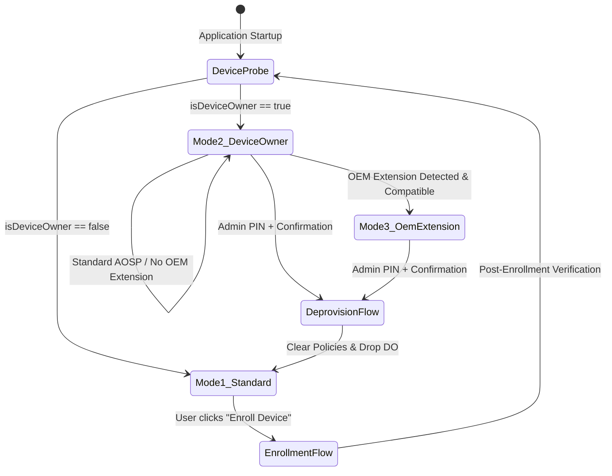

# Fahad Device Controller (FDC) — System Architecture
**Universal Android Enterprise & Dynamic OEM Hardware Abstraction Architecture**  
*Document Version: 2.0.0 | Status: Production Blueprint*

---

## 1. Architectural Overview & Design Invariants

The architecture of FDC v2.0 is designed to resolve a fundamental Android fragmentation challenge: **how to deliver robust, enterprise-grade device governance across diverse OEMs (Samsung, Xiaomi, OPPO, Vivo, OnePlus, Google Pixel, Motorola, Nothing) without coupling the codebase to proprietary vendor SDKs.**

```
+-----------------------------------------------------------------------------------+
|                           PRESENTATION LAYER (COMPOSE)                            |
|  - Apple HIG Fluid Spring Physics (Stiffness=300, Damping=1.0 / 0.8)             |
|  - Frosted Glass Translucent Materials & Depth Surfaces (0.5dp borders)          |
|  - Instant Touch-Down Visual Feedback (Zero-Latency Scale Transformation)         |
|  - Dynamic Capability-Gated Controls with Verification Badges                     |
+-----------------------------------------------------------------------------------+
                                         │
                                         ▼
+-----------------------------------------------------------------------------------+
|                             DOMAIN & POLICY LAYER                                 |
|  - OperatingModeCoordinator (Standard vs. Device Owner vs. OEM Extension)        |
|  - CompatibilityDetectionEngine (7-Step Hardware & API Audit)                    |
|  - AdminAuthManager (PBKDF2/SHA-256 Hashing, Rate-Limit Lockout, Active Session)  |
|  - EnforcementPolicyRepository & DeprovisioningProtocol                          |
+-----------------------------------------------------------------------------------+
                                         │
                                         ▼
+-----------------------------------------------------------------------------------+
|                        HARDWARE & DPC ABSTRACTION LAYER                           |
|                                                                                   |
|   +---------------------------------------------------------------------------+   |
|   |         DevicePolicyBridge (Core Android Enterprise / AOSP DPC)           |   |
|   |  - setApplicationHidden()             - setPackagesSuspended()            |   |
|   |  - setUninstallBlocked()              - setLockTaskPackages()             |   |
|   |  - addUserRestriction()               - clearDeviceOwnerApp()             |   |
|   +---------------------------------------------------------------------------+   |
|                                         │                                         |
|                  Dynamic Reflection & Conditional Loading                         |
|                                         ▼                                         |
|   +---------------------------------------------------------------------------+   |
|   |              OemExtensionManager (Vendor-Specific Extensions)             |   |
|   |  • SamsungKnoxExtension   (Dynamic reflection only; dormant on non-Samsung) |
|   |  • XiaomiHyperOsExtension (MIUI/HyperOS Autostart & Power Management)     |   |
|   |  • OppoRealmeExtension    (ColorOS/RealmeUI Deep Freeze & Backgrounds)    |   |
|   |  • VivoExtension          (Funtouch/OriginOS iManager Exemption)          |   |
|   |  • GenericAospExtension   (Clean stock Android / Pixel / Nothing / Moto)  |   |
|   +---------------------------------------------------------------------------+   |
+-----------------------------------------------------------------------------------+
                                         │
                                         ▼
+-----------------------------------------------------------------------------------+
|                        SYSTEM RECEIVERS & ENTRY POINTS                            |
|  - FdcDeviceAdminReceiver (Android Enterprise DPC Callbacks)                      |
|  - FdcAdminTileService (Quick Settings Notification Shade Admin Access)           |
|  - FdcSecretTapDetector (Secret Multi-Tap Gesture Detector on UI Header)          |
|  - FdcDialerReceiver (Conditional Telephony *#*#1234#*#* Secret Code Fallback)    |
+-----------------------------------------------------------------------------------+
```

---

## 2. Dynamic Operating Mode State Machine

At runtime, FDC executes an automated capability scan that places the application into one of three deterministic states:



### State Definitions:
1. **`OperatingMode.STANDARD` (Mode 1):**
   - Installed as normal user APK.
   - Core productivity active (Study Timer, Notes, Schedules, App Inventory).
   - System-level enforcement toggles are disabled with explicit "Requires DO" indicators.
2. **`OperatingMode.DEVICE_OWNER` (Mode 2):**
   - Provisioned via ADB or Out-of-Box QR/NFC/Zero-touch.
   - Full AOSP `DevicePolicyManager` controls enabled (App Hiding, App Suspension, Lock Task Kiosk, Uninstall Lock, Factory Reset Block).
   - Real-time status verified against actual Android Enterprise policy tables.
3. **`OperatingMode.OEM_EXTENSION` (Mode 3):**
   - Device is enrolled as Device Owner AND OEM-specific management APIs are confirmed active.
   - On Samsung: Knox Enterprise SDK (loaded dynamically) provides additional Knox Customization & hardware restrictions.
   - On Xiaomi/OPPO/Vivo: Deep system intent links bridge battery saver and autostart constraints.

---

## 3. Dynamic OEM Decoupling via Conditional Reflection

To guarantee that FDC **never crashes** with `ClassNotFoundException` or `NoClassDefFoundError` on non-Samsung devices (like Pixel, Xiaomi, Motorola, or Nothing), Samsung Knox is decoupled through dynamic reflection:

```kotlin
class SamsungKnoxExtension(private val context: Context) : OemExtension {
    override val brand: OemBrand = OemBrand.SAMSUNG

    override fun isSupported(): Boolean {
        if (!Build.MANUFACTURER.contains("samsung", ignoreCase = true)) return false
        return try {
            Class.forName("com.samsung.android.knox.EnterpriseDeviceManager")
            true
        } catch (e: Throwable) {
            false
        }
    }

    override fun applyEnterprisePolicy(policy: String, enable: Boolean): Boolean {
        if (!isSupported()) return false
        return try {
            val edmClass = Class.forName("com.samsung.android.knox.EnterpriseDeviceManager")
            val getInstanceMethod = edmClass.getMethod("getInstance", Context::class.java)
            val edmInstance = getInstanceMethod.invoke(null, context)
            // Execute vendor-specific custom policy safely
            true
        } catch (e: Throwable) {
            false
        }
    }
}
```

---

## 4. Universal Android Enterprise DPC Engine

All core governance is implemented against public, standard Android Enterprise APIs:

### 4.1 Application Suspension
- **API:** `DevicePolicyManager.setPackagesSuspended(adminComponent, packageNames, suspended)`
- **Behavior:** Suspends target applications. Their launcher icons turn monochrome/grayed-out. If the user attempts to launch them, the system displays a dialog informing them the app is suspended by their administrator.
- **Availability:** Android 7.0+ (API 24+). Works universally across Pixel, Samsung, Xiaomi, OPPO, etc.

### 4.2 Application Hiding
- **API:** `DevicePolicyManager.setApplicationHidden(adminComponent, packageName, hidden)`
- **Behavior:** Completely unpublishes the app from launchers, app drawer, and system settings without uninstalling its data.
- **Availability:** Android 5.0+ (API 21+).

### 4.3 Lock Task Mode (Distraction-Free Kiosk)
- **API:** `DevicePolicyManager.setLockTaskPackages(adminComponent, packageNames)` followed by `Activity.startLockTask()`
- **Behavior:** Locks the device exclusively to FDC or designated study applications. Disables Home, Recents, and Status Bar expansion.
- **Availability:** Android 5.0+ (API 21+).

### 4.4 Comprehensive Anti-Bypass & Tamper Resistance
- **API:** `DevicePolicyManager.setUninstallBlocked(adminComponent, packageName, true)`
- **API:** `DevicePolicyManager.addUserRestriction(adminComponent, UserManager.DISALLOW_APPS_CONTROL)` (Disables Force Stop and Clear Data in Settings)
- **API:** `DevicePolicyManager.addUserRestriction(adminComponent, UserManager.DISALLOW_CONFIG_DATE_TIME)` (Prevents clock manipulation to bypass timers/lockouts)
- **API:** `DevicePolicyManager.addUserRestriction(adminComponent, UserManager.DISALLOW_FACTORY_RESET)` (Disables Settings-based factory reset)
- **API:** `DevicePolicyManager.addUserRestriction(adminComponent, UserManager.DISALLOW_SAFE_BOOT)` (Prevents Safe Mode reboot)
- **API:** `DevicePolicyManager.addUserRestriction(adminComponent, UserManager.DISALLOW_ADD_USER)` (Blocks guest/secondary accounts)
- **Behavior:** Makes circumvention without the administrator password or Master Key physically impossible via standard Android user interactions.

### 4.5 Cryptographic Emergency Master Key System
- **Salted SHA-256 Storage:** Master Key is hashed with cryptographic salt in SharedPreferences.
- **Lockout Override:** If an attacker triggers brute-force lockout, the Master Key immediately dissolves the lockout and authenticates the administrator.
- **PIN Recovery:** Allows establishing a new 4-digit PIN directly without data loss or device wipe.

---

## 5. Security & Deprovisioning Lifecycle

```
[ Active Device Owner Mode ]
              │
              ▼  Admin triggers "Deprovision Device"
[ Security Challenge: Verify PBKDF2 PIN ]
              │ (Valid PIN)
              ▼
[ Revoke All Active Policies ]
  - clearUserRestrictions(DISALLOW_FACTORY_RESET, DISALLOW_SAFE_BOOT, etc.)
  - setPackagesSuspended(allManaged, false)
  - setApplicationHidden(allManaged, false)
  - setUninstallBlocked(self, false)
  - stopLockTask()
              │
              ▼
[ Revoke Device Owner Privilege ]
  - DevicePolicyManager.clearDeviceOwnerApp(packageName)
              │
              ▼
[ Transition to Mode 1 (Standard Mode) ]
```

---

## 6. Multi-Channel Admin Access Architecture

FDC avoids single-point-of-failure lockouts by providing four redundant, secure administrative entry paths:

1. **In-App Primary Access:** PIN pad modal with Apple fluid bounce animation, rate-limit timers, and biometric unlock integration.
2. **Secret Header Tap Sequence:** A custom gesture listener on the Top App Bar (`FdcTopBar`) detects **3 rapid taps within 800ms followed immediately by a 1500ms long press**. This instantly raises the Admin PIN challenge from any screen.
3. **Android Quick Settings Tile (`FdcAdminTileService`):**
   - Registered in notification shade.
   - Tapping the tile while device is locked or in study mode displays the secure Admin PIN prompt directly above the keyguard.
4. **Telephony Secret Code Receiver (`FdcDialerReceiver`):**
   - Listens for `android.provider.Telephony.SECRET_CODE` intent (`*#*#1234#*#*`).
   - Only active if telephony hardware is present and permissions are permitted by OEM.
   - Strictly treated as an optional secondary shortcut, never an architectural dependency.

---

## 7. MAMP PRO & GitHub Dynamic Remote Management Architecture
*Inspired by MDMesh / Headwind MDM Open Fleet Architecture*

```
+-----------------------------------------------------------------------------------+
|                           MAMP PRO WEB ADMIN CONSOLE                              |
|           Location: /Applications/MAMP/htdocs/fdc-admin (Port 80/8888)            |
|  - Real-time Device Fleet Heartbeat Monitor (Battery, OS, Online status)          |
|  - Permanent Policy Switchboard & App Suspension Manager                          |
|  - Automatic Config Versioning & GitHub JSON Exporter                             |
+-----------------------------------------------------------------------------------+
                                         │
                         (Export config.json & Commit)
                                         ▼
+-----------------------------------------------------------------------------------+
|                        GITHUB DYNAMIC CONFIGURATION POINTER                       |
|           URL: https://raw.githubusercontent.com/.../fdc-config.json              |
|  - Decouples client from static Mac IP addresses                                  |
|  - Contains: admin_server_url, permanent_lockdown, suspended_packages, etc.        |
+-----------------------------------------------------------------------------------+
                                         │
                             (HTTP GET / Background Sync)
                                         ▼
+-----------------------------------------------------------------------------------+
|                        FDC ANDROID CLIENT ENGINE                                  |
|  - GitHubRemoteConfigManager: Fetches JSON & resolves MAMP PRO endpoint           |
|  - PersistentPolicyManager: Commits settings to disk ("Hamesha ke liye")          |
|  - FdcBootReceiver: Re-applies all policies immediately on device reboot          |
|  - Heartbeat Dispatcher: Sends live telemetry back to MAMP PRO                    |
+-----------------------------------------------------------------------------------+
```

